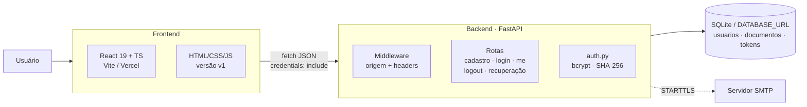

<div align="center">


# ∞ Hackthon — Autenticação Full-Stack

**Sistema completo de cadastro, login e recuperação de senha, construído durante um hackathon da Infinity School.**
Backend em **FastAPI + SQLAlchemy** com foco em segurança e frontend migrado de HTML/CSS/JS puro para **React 19 + TypeScript + Vite**.


<br/>


[Sobre](#-sobre-o-projeto) •
[Funcionalidades](#-funcionalidades) •
[Segurança](#-segurança) •
[Arquitetura](#-arquitetura) •
[Como rodar](#-como-rodar) •
[API](#-api) •
[Testes](#-testes) •
[Roadmap](#-roadmap)

</div>

---

## 📌 Sobre o projeto

O **Infinity** é o módulo de autenticação de uma plataforma web, desenvolvido em equipe durante um hackathon. O objetivo foi entregar um fluxo de contas **pronto para produção**, e não apenas telas bonitas: validação de dados brasileiros (CPF), senhas com hash, sessões seguras em cookie e recuperação de senha por e-mail com tokens de uso único.

O projeto passou por duas fases:

1. **v1 — HTML, CSS e JavaScript puro**, servidos pelo próprio FastAPI (mesma origem, sem CORS).
2. **v2 — Migração para React + TypeScript**, com componentes reutilizáveis, rotas client-side e deploy preparado para a Vercel.

## ✨ Funcionalidades

| Fluxo | O que faz |
|---|---|
| 📝 **Cadastro** | Nome, CPF, e-mail e senha. CPF validado pelos **dígitos verificadores**, e-mail normalizado e duplicidade bloqueada (HTTP 409). |
| 🔐 **Login** | Aceita **CPF ou e-mail** no mesmo campo. Gera sessão de 8 horas em cookie `HttpOnly`. |
| 👤 **Sessão** | `GET /me` retorna o usuário logado; `POST /logout` invalida o token no banco. |
| 📧 **Recuperar senha** | Envia link por e-mail (SMTP + STARTTLS) válido por **30 minutos** e de **uso único**. |
| 🔁 **Redefinir senha** | Troca a senha e **encerra todas as sessões ativas** do usuário. |
| 📱 **Responsividade** | Telas de autenticação adaptadas para desktop e mobile. |

## 🛡️ Segurança

Segurança foi tratada como requisito, não como detalhe:

- **Senhas com bcrypt** (salt por usuário) e limite de 72 bytes, respeitando a restrição do algoritmo.
- **Tokens nunca salvos em texto puro**: sessão e recuperação são guardadas como hash **SHA-256**. Um vazamento do banco não expõe tokens válidos.
- **Cookie `HttpOnly` + `SameSite=Lax`**, com `Secure` configurável para produção (HTTPS).
- **Proteção contra CSRF por verificação de origem**: requisições `POST/PUT/PATCH/DELETE` de outra origem recebem `403`.
- **Sem enumeração de usuários**: a recuperação de senha responde exatamente igual para e-mails cadastrados e não cadastrados.
- **Headers defensivos**: `Referrer-Policy: no-referrer` e `Cache-Control: no-store` nas rotas sensíveis.
- **Superfície mínima de arquivos estáticos**: só as pastas de frontend são publicadas; `banco.db`, código e configuração retornam `404`.
- **CPF isolado em tabela própria** (`documentos`), preservando a tabela de usuários e permitindo que contas antigas entrem por e-mail.

## 🏗️ Arquitetura



### Modelo de dados

| Tabela | Campos | Função |
|---|---|---|
| `usuarios` | `id`, `nome`, `email` (único), `senha` (hash) | Conta do usuário |
| `documentos` | `cpf` (PK), `usuario_id` (único) | Vincula CPF à conta |
| `tokens` | `digest` (SHA-256), `usuario_id`, `finalidade`, `expira` | Sessões e links de recuperação |

### Estrutura de pastas

```
HACKTHON/
├── banco/app/            # ✅ Backend ativo (FastAPI)
│   ├── main.py           #    Rotas, middleware e envio de e-mail
│   ├── auth.py           #    bcrypt + geração/hash de tokens
│   ├── models.py         #    Modelos SQLAlchemy
│   ├── schemas.py        #    Validação Pydantic (CPF, e-mail, senha)
│   ├── database.py       #    Engine e sessão
│   └── crud.py
├── frontend/             # ⚛️ Frontend React + TypeScript (v2)
│   └── src/
│       ├── pages/        #    Login, Cadastro, RecuperarSenha, RedefinirSenha
│       ├── components/   #    AuthLayout, CampoSenha
│       └── services/     #    Cliente HTTP tipado (api.ts, auth.ts)
├── Login/ Cadastro/ Redefinir/ assets/   # 🌐 Frontend v1 (HTML/CSS/JS)
├── tests/test_auth.py    # 🧪 Testes de integração da API
├── iniciar.py            # 🚀 Inicializador do servidor
└── requirements.txt
```

> As demais pastas dentro de `banco/` (`models`, `routes`, `services`, `repositories`, `schemas`) são rascunhos de uma arquitetura anterior. O código em produção é o de `banco/app`.

## 🚀 Como rodar

### Pré-requisitos

- Python **3.10+**
- Node.js **20+** (apenas para o frontend React)

### 1. Backend + frontend v1

```bash
git clone https://github.com/DevWizardMarcos/HACKTHON.git
cd HACKTHON

python -m venv .venv
# Windows
.\.venv\Scripts\activate
# Linux / macOS
source .venv/bin/activate

pip install -r requirements.txt
python iniciar.py --reload
```

Acesse **http://127.0.0.1:8000**. O mesmo servidor entrega as telas e a API.
Documentação interativa (Swagger): **http://127.0.0.1:8000/docs**

> ⚠️ Não abra os arquivos HTML diretamente nem pelo Live Server: a integração depende da mesma origem.
> Se aparecer `No module named 'banco'`, rode o comando a partir da raiz `HACKTHON`.

### 2. Frontend React (v2)

Com o backend rodando na porta 8000:

```bash
cd frontend
cp .env.example .env
npm install
npm run dev
```

Em desenvolvimento, o Vite redireciona `/api/*` para o FastAPI, sem problemas de CORS.

| Script | Descrição |
|---|---|
| `npm run dev` | Servidor de desenvolvimento |
| `npm run build` | Checagem de tipos + build de produção |
| `npm run lint` | Lint com Oxlint |
| `npm run preview` | Pré-visualiza o build |

### ⚙️ Variáveis de ambiente

**Backend** (definidas no ambiente do processo; o `.env` não é carregado automaticamente):

| Variável | Padrão | Descrição |
|---|---|---|
| `DATABASE_URL` | `sqlite:///banco.db` | String de conexão do banco |
| `PUBLIC_BASE_URL` | `http://127.0.0.1:8000` | Base do link enviado por e-mail |
| `COOKIE_SECURE` | `false` | Use `true` em produção (HTTPS) |
| `SMTP_HOST` / `SMTP_PORT` | — / `587` | Servidor de e-mail |
| `SMTP_FROM` | — | Remetente |
| `SMTP_USER` / `SMTP_PASSWORD` | — | Credenciais SMTP |

Exemplo no PowerShell:

```powershell
$env:SMTP_HOST = "smtp.seu-provedor.com"
$env:SMTP_FROM = "no-reply@seu-dominio.com"
$env:SMTP_USER = "seu-usuario"
$env:SMTP_PASSWORD = "sua-senha"
```

Sem SMTP configurado, a recuperação responde `503` e a tela informa que o envio está indisponível.

**Frontend:**

| Variável | Padrão | Descrição |
|---|---|---|
| `VITE_API_URL` | `/api` | URL da API. Na Vercel, use a URL pública do backend |

## 📡 API

| Método | Rota | Corpo | Resposta |
|---|---|---|---|
| `POST` | `/cadastro` | `nome`, `cpf`, `email`, `senha` | `201` usuário · `409` duplicado · `422` inválido |
| `POST` | `/login` | `identificador` (CPF ou e-mail), `senha` | `200` + cookie de sessão · `401` |
| `GET` | `/me` | — | `200` usuário logado · `401` |
| `POST` | `/logout` | — | `200` sessão encerrada |
| `POST` | `/recuperar-senha` | `email` | `200` (resposta neutra) · `503` sem SMTP |
| `POST` | `/redefinir-senha` | `token`, `senha` | `200` · `400` link inválido/expirado |

<details>
<summary><b>Exemplo de requisição</b></summary>

```bash
curl -X POST http://127.0.0.1:8000/cadastro \
  -H "Content-Type: application/json" \
  -d '{"nome":"Ana Souza","cpf":"529.982.247-25","email":"ana@example.com","senha":"Senha123!"}'
```

```json
{ "id": 1, "nome": "Ana Souza", "email": "ana@example.com" }
```
</details>

## 🧪 Testes

Testes de integração com `unittest` + `TestClient`, usando banco temporário isolado:

```bash
python -m unittest discover -s tests -v
```

Cobrem:

- ✅ Cadastro, login por CPF e por e-mail (case-insensitive), `/me` e logout
- ✅ Senha nunca armazenada em texto puro e nunca retornada pela API
- ✅ Validação de CPF, e-mail, nome e senha (incluindo limite de 72 bytes)
- ✅ Fluxo completo de recuperação: token salvo só como hash, uso único e sessões encerradas após a troca
- ✅ Token expirado rejeitado
- ✅ Bloqueio de requisições de outra origem e banco de dados inacessível via HTTP

## 🗺️ Roadmap

- [ ] Login social com Google e Apple
- [ ] Área logada (dashboard) após autenticação
- [ ] Rate limiting em login e recuperação
- [ ] Deploy do backend e integração com o frontend na Vercel
- [ ] Remoção dos rascunhos antigos em `banco/`
- [ ] CI com GitHub Actions rodando testes e lint

## 👥 Equipe

<table>
  <tr>
    <td align="center">
      <a href="https://github.com/DevWizardMarcos">
        <br/>
        <b>Marcos Simões</b>
      </a><br/>
      <sub>Front-end · Full-stack</sub>
    </td>
    <td align="center">
      <a href="https://github.com/PabloMartins031">
        <br/>
        <b>Pablo Martins</b>
      </a><br/>
      <sub>Contribuidor</sub>
    </td>
  </tr>
</table>

---

<div align="center">

Feito durante o hackathon da **Infinity School** 💙🧡

[](https://portifolinodev.vercel.app)
[](https://github.com/DevWizardMarcos)

</div>
